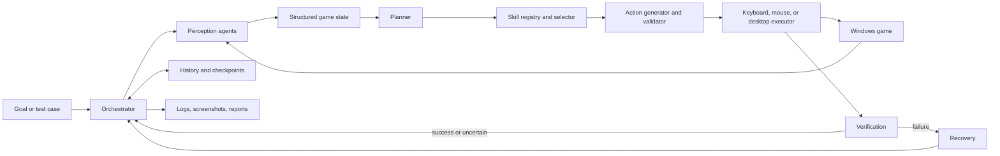
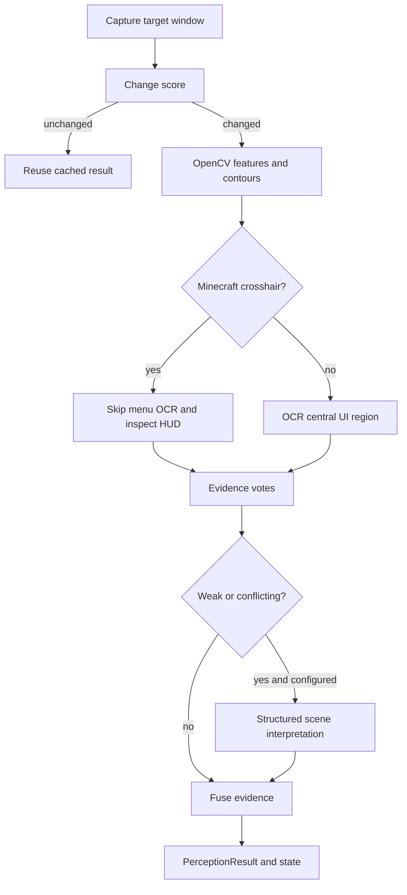

# PC Multi-Agent Gaming Automation Framework (PC-GAF)

## Abstract, Outline, Architecture, and Viva Reference

**Platform:** Windows PC  
**Distribution target:** Xbox PC application / PC Game Pass  
**Primary game:** Minecraft for Windows  
**Secondary adapter:** Among Us  
**Stage:** Functional engineering prototype under stabilization  
**Viva framing:** A proposed production framework supported by a working codebase baseline

---

## 1. Abstract

PC-GAF is a proposed multi-agent framework for launching, observing, controlling, testing, and validating Windows PC games. It will interact through the visible screen and normal operating-system input: capture the current game window, determine its state, select an approved skill, translate the skill into bounded keyboard or mouse actions, execute it, observe the result, and recover when the expected result is not obtained.

The first target will be games installed through the Xbox PC application. Minecraft for Windows will be the reference implementation because it covers the complete path from desktop launch to menu navigation and in-world actions. An Among Us adapter will demonstrate how another game can reuse the same orchestration engine.

The system will use a feedback loop instead of a fixed macro. Screen capture, OpenCV measurements, optical character recognition, game-specific visual rules, and optional vision-language interpretation will produce structured evidence. A planner will select only from registered YAML skills. A separate action layer will validate and translate the skill into deterministic input. Verification and recovery agents will check each important result and apply bounded recovery.

The repository contains a working prototype of this design: orchestration, agents, screen perception, skills, Windows controls, Minecraft launch and gameplay, checkpointing, logging, adapters, and tests. Production completion will require configuration cleanup, full memory/report integration, reliability testing across machines, stronger goal-completion logic, packaging, security review, performance measurement, and resolution of remaining launch-flow issues.

---

## 2. Problem Statement

Traditional PC game automation relies on recorded macros, fixed screen coordinates, and predetermined delays. It fails when a game launches slowly, a window moves, display scaling changes, a button changes position, or an action does not produce the expected transition.

> How can a reusable Windows framework launch different PC games, understand their current visual state, perform controlled actions, verify outcomes, recover from failures, and preserve evidence for automated game testing?

The main challenge is not pressing a key. It is deciding when the key is relevant, ensuring that the correct window owns the foreground, proving that the action worked, and selecting the next step from the new screen state.

---

## 3. Aim and Objectives

The aim is to develop a modular, observable, safe, and extensible multi-agent framework for automating Windows PC game workflows through visual perception and deterministic input.

The framework will:

1. Launch supported games through the Xbox PC application.
2. Detect desktop, Xbox, loading, menu, gameplay, dialog, result, and error states.
3. Fuse pixel measurements, screen text, game rules, and optional scene interpretation.
4. Represent observations, decisions, actions, and outcomes as typed data.
5. Restrict planning to an approved skill registry.
6. Convert skills into bounded keyboard and mouse actions.
7. Prevent input when the target game is not in the foreground.
8. Verify important actions by observing the screen again.
9. Recover from uncertain perception, missed clicks, stalls, and focus loss.
10. Preserve recent history and graph checkpoints.
11. Produce structured logs, screenshots, and future run reports.
12. Add games through adapters and YAML packages without changing the core graph.
13. Support functional, visual, regression, performance, and endurance game testing.

---

## 4. Scope

### Included in the prototype

- Windows desktop and Xbox application automation.
- Minecraft launch, menu navigation, and in-world input.
- A secondary Among Us adapter and skills.
- Full-screen, region, and game-window capture.
- OpenCV features and screen-change detection.
- RapidOCR/ONNX by default and PaddleOCR as fallback.
- Optional OpenAI or Anthropic planning and visual interpretation.
- Deterministic offline planning when no provider key is available.
- YAML skills with typed parameters and preconditions.
- Safe keyboard/mouse execution, verification, and bounded recovery.
- LangGraph orchestration, checkpointing, JSON logs, and screenshots.
- Unit, integration, and opt-in live desktop tests.

### Outside the present production scope

- Kernel drivers, anti-cheat bypassing, memory modification, or packet manipulation.
- Competitive public play or unattended interaction with other players.
- Console, Linux, or macOS automation.
- Cloud-distributed workers and external issue-tracker integration.
- Complete world mapping and long-horizon strategy for every game.
- Production monitoring, access control, and centralized secret management.

The framework will remain an external black-box testing system that observes pixels and sends normal OS input.

---

## 5. Current Status

The viva should present this as a system that **will be completed as a production framework**, supported by an existing functional prototype.

| Area | Present codebase | Work before production |
|---|---|---|
| Orchestration | Typed LangGraph cycle implemented | Endurance and failure-injection testing |
| Minecraft launch | Declarative screen-driven state machine implemented | Stabilize across app/game versions and layouts |
| Minecraft gameplay | Movement, camera, jump, mine, place, attack implemented | Richer goals and environment understanding |
| Among Us | Adapter, state, actions, and skills implemented | Live end-to-end validation and map-aware behavior |
| Perception | OpenCV, OCR, fusion, Minecraft HUD rules, optional visual model | Labelled accuracy evaluation and calibration |
| Planning | Structured provider path and offline rules | Goal decomposition and reliable completion detection |
| Skills | 28 common, 28 Minecraft, 8 Among Us definitions | Enforce every timeout/retry contract at runtime |
| Memory | Graph state/history and checkpoints active | Connect prepared SQLite run memory |
| Reports | JSON reporter class exists | Connect it to graph completion |
| Safety | Focus checks, bounds, dry run, release-on-error | Register configured global emergency hotkey |
| Tests | Broad automated suite and live tests | Resolve remaining failure and add CI/hardware matrix |

---

## 6. Architecture



The planner will produce a `SkillIntent`; it will not generate unrestricted OS commands. Only the validated executor will contact Windows.

---

## 7. End-to-End Workflow

```text
INITIALIZE -> LOAD SKILLS -> CAPTURE -> PERCEIVE -> UPDATE STATE
-> PLAN ONE SKILL -> CHECK PRECONDITIONS -> APPLY/CLAMP PARAMETERS
-> GENERATE ACTION PLAN -> VALIDATE -> EXECUTE -> OBSERVE AGAIN
-> VERIFY
   SUCCESS   -> capture next state
   UNCERTAIN -> observe again
   FAILURE   -> bounded recovery
-> FINISH on objective, iteration limit, emergency stop, or exhausted recovery
```

1. The CLI receives the game, goal, limit, and launch/dry-run/persistence settings.
2. The orchestrator creates a run ID and game-specific initial state.
3. Common skills load first; the selected game's skills load next.
4. Perception captures the target game window where possible.
5. Frame change detection may reuse cached perception for an unchanged screen.
6. OpenCV measures brightness, edges, motion, text regions, UI rectangles, colours, and contours.
7. OCR reads menu text unless Minecraft crosshair evidence makes menu OCR unnecessary.
8. Optional visual interpretation runs only for weak, conflicting, or escalated evidence.
9. Weighted evidence produces one screen state and confidence.
10. The game adapter converts generic perception into Minecraft or Among Us state.
11. The planner selects one currently available skill.
12. The registry checks preconditions and parameter limits.
13. The action layer builds and validates typed plans.
14. The executor checks focus and sends bounded input.
15. A new observation is compared with the skill's expected result.
16. Recovery re-observes, reruns perception, escalates, retries, or returns to a known state.
17. State, logs, and selected screenshots preserve evidence.
18. The run ends safely at an explicit terminal condition.

---

## 8. Agent Responsibilities

### Orchestrator Agent

`agents/orchestrator/graph.py` will coordinate graph nodes, conditional edges, run IDs, loop limits, checkpoints, and finish conditions.

### Launch Agent

`agents/launch/launch_agent.py` will read the declarative Xbox/Minecraft states from YAML, match the live screen, perform the corresponding action, and observe again. It will use progress-based timeouts instead of a blind timed macro.

### Perception Agent

`agents/perception/perception_agent.py` will coordinate capture, caching, OpenCV, OCR, optional scene interpretation, evidence fusion, and screenshot references.

### OCR and Vision Agents

`ocr_agent.py` will manage text recognition and confidence. `vision_agent.py` will expose deterministic visual operations. Minecraft pixel rules will remain in `tools/vision/minecraft_vision.py`.

### Evidence Fuser and State Builder

The fuser will combine OpenCV (`0.40`), OCR (`0.35`), and optional visual-model (`0.25`) votes. Agreement adds confidence. The state builder will merge the result and allow stronger game evidence, such as a Minecraft crosshair, to override a generic classification.

### Planner Agent

`agents/planner/planner_agent.py` will receive structured evidence, recent history, the user goal, and only skills whose preconditions pass. It will return exactly one skill intent. It supports provider-backed structured output and deterministic offline rules.

### Skill Agent

`agents/skills/skill_agent.py` will load and validate YAML, evaluate preconditions, filter available skills, clamp parameters, and resolve the chosen skill.

### Action Agent

`agents/execution/action_agent.py` will create `ActionPlan` records and reject incomplete or unsafe plans. It will never touch the OS.

### Execution Agents

`tools/input/keyboard.py`, `tools/input/mouse.py`, and `tools/desktop/` form the physical-control boundary. They support key taps/holds/releases, combinations, absolute and relative mouse movement, clicks, holds, drags, waits, window focus, and Xbox UI Automation.

### Verification Agent

`agents/verification/verifier.py` will check position change, text present/absent, screen transition, task progress, menu open/close, object presence, or exact state. Skills with no postcondition use a fast path and rely on the next normal observation.

### Recovery Agent

`agents/recovery/recovery_agent.py` will apply bounded re-observation, OCR/vision rerun, visual escalation, retry, parameter adjustment, alternative skill, or return-to-known-state strategies. Exhaustion terminates the run.

### Deterministic Minecraft Controller

`agents/gameplay/minecraft_gameplay.py` provides a separate mechanic-test path. After a stable crosshair appears for consecutive frames, it directly tests movement, camera, jump, attack, breaking, and placement through the same safe executors.

---

## 9. Technology Stack

| Layer | Technology | Role |
|---|---|---|
| Language | Python 3.11+ | Main implementation |
| Workflow | LangGraph | Cyclic graph, routing, checkpoints |
| Model integration | LangChain | Structured planning and tool wrappers |
| Contracts/config | Pydantic, pydantic-settings, YAML, `.env` | Validation and configuration |
| Vision | OpenCV, NumPy | Change detection, features, contours, HUD analysis |
| Capture | MSS, Pillow | Window/desktop image acquisition |
| OCR | RapidOCR, ONNX Runtime, PaddleOCR/PaddlePaddle | Screen-text recognition |
| Windows UI | pywinauto UIA3, COM types, PyWin32 | Window discovery, focus, Xbox actions |
| Input | pynput, keyboard | Keyboard, mouse, and future hotkey listener |
| Providers | OpenAI, Anthropic | Optional planning and visual interpretation |
| Logging | structlog, Python logging | JSON events with run context |
| Persistence | SQLite, JSON | Checkpoints, future memory and reports |
| Testing | pytest | Unit, integration, live tests |
| Packaging | setuptools; Ruff configuration | Installation and quality baseline |

---

## 10. Models and Decision Systems

The repository currently configures:

- planner: `claude-haiku-4-5-20251001` through Anthropic;
- visual scene analysis: `claude-sonnet-4-6` through Anthropic;
- OpenAI-compatible typed defaults: `gpt-4o-mini` for planning and `gpt-4o` for vision;
- RapidOCR with ONNX Runtime as the preferred OCR backend;
- PaddleOCR as the heavier fallback.

Provider, model ID, temperature, token limit, and timeout are configuration values. No provider is mandatory: deterministic planning operates offline. OpenCV features and Minecraft HUD rules are deterministic rather than trained models.

A network model will never be the only authority for physical input. It may select a registered skill or contribute a structured scene vote. Registry, validation, foreground checks, and execution remain deterministic boundaries.

---

## 11. Perception Pipeline



The pipeline starts with cheap measurements, reuses unchanged results, runs OCR only when useful, and escalates only for ambiguity. Screenshot references, not raw images, are stored in graph state. Per-Monitor V2 DPI awareness keeps OCR and click coordinates in one physical-pixel space; rectangle models allow negative multi-monitor coordinates.

---

## 12. Skill System

A YAML skill declares its name, category, preconditions, perception needs, typed parameters, action strategy, expected result, verification, timeout, retry policy, and recovery order.

```yaml
- skill: mc_move
  game: minecraft
  category: game_specific
  preconditions: ["state.screen == gameplay"]
  perception: [screenshot]
  parameters:
    direction: {type: string, default: forward}
    duration_ms: {type: integer, min: 50, max: 2000, default: 400}
  action_strategy: game_specific
  expected_result: player_moved
  verification_strategy: none
  timeout_ms: 3000
  retry: {max_attempts: 1, backoff_ms: 50}
  recovery: [reobserve, retry]
```

| Loaded package | Common | Game-specific | Total |
|---|---:|---:|---:|
| Minecraft | 28 | 28 | 56 |
| Among Us | 28 | 8 | 36 |

Common groups cover interaction, keyboard, mouse, navigation, perception, verification, and recovery. Minecraft adds Xbox launch, menu navigation, movement, camera, mining, placement, combat, inventory, pause, HUD perception, and closed-loop behaviors. Among Us adds room/task navigation, task interaction, reporting, voting, vent use, and screen detection.

---

## 13. Memory

Memory will exist at four levels:

1. **Current graph state:** run ID, game, goal, structured state, intent, action plan/result, perception, verification, iteration, finish flags, and node log.
2. **Bounded history:** the latest 25 `HistoryEntry` records, containing skill, action, verification, state, note, and timestamp.
3. **Graph checkpoints:** `InMemorySaver` by default and an optional SQLite saver requested through `--persist`; the run ID becomes the LangGraph thread ID.
4. **Long-term memory:** `memory/long_term.py` already defines SQLite run and iteration tables plus JSON export.

The long-term class is not yet connected to the graph lifecycle. Production integration will record run start, every verified iteration, finish, and historical retrieval. The standalone `ShortTermMemory` buffer is also not wired because graph history currently supplies that behavior.

Memory will support resumption, failure comparison, repeated-action avoidance, build-to-build analysis, and reproducible defect evidence.

---

## 14. Infrastructure

The present framework runs as a local Windows process in an unlocked interactive desktop session.

Configuration is intended to flow as:

```text
typed defaults -> YAML configuration -> environment values
```

- `configs/app.yaml`: game, limits, logging, provider, models.
- `configs/perception.yaml`: thresholds, change detection, OCR, cache, escalation.
- `configs/execution.yaml`: focus, timings, dry run, emergency-hotkey label.
- `.env`: local secrets and machine overrides; excluded by `.gitignore`.

`structlog` writes JSON events to stdout and `logs/pcgaf.log`. LangGraph uses an in-memory checkpointer by default and attempts a SQLite saver for persistent mode. `infrastructure/persistence.py` contains a JSON `RunReporter`, but the graph does not call it yet. Production work will add rotation, retention, redaction, metrics, report wiring, database migrations, and resume-by-run-ID.

---

## 15. Safety

- Target-window foreground validation and best-effort re-focus.
- Dry-run mode that sends no physical input.
- Minimum/maximum key-hold duration.
- Relative mouse-delta clamping.
- Absolute coordinate bounds checks.
- Guaranteed release of held keys and buttons.
- Tracked held-input state for crash recovery.
- Skill preconditions and typed action validation.
- Iteration, recovery, state-action, stall, and hard-cap limits.
- Planning separated from physical execution.
- Emergency-stop event propagation.

The configuration names `esc+esc+esc` as the intended emergency hotkey. The event is implemented and tested, but a global listener for that configured sequence has not yet been registered. This remains a production task.

---

## 16. Minecraft Workflow

### Launch state machine

```text
desktop -> xbox_home -> search_results -> game_card -> game_launching
        -> mc_title -> world_select -> loading -> in_world
```

The agent will launch Xbox through the `xbox:` protocol, maximize its real UWP window, search for Minecraft for Windows, exclude unrelated editions, open the card, distinguish a true Play button from headings such as “Play with Game Pass,” wait for Minecraft, select Play and a world, and confirm entry through the center crosshair.

Configured controls include a 180-second no-progress stall timeout, 1,500-second hard cap, 0.5-second poll interval, three-cycle confusion threshold, eight-action same-state budget, three-failure visual-call circuit breaker, and approximately 60 seconds of crosshair polling after world entry.

### In-world state and actions

Minecraft state includes phase, world-loaded flag, crosshair, health, hunger, hotbar slot, block hint, outdoor estimate, mob count, brightness, time-of-day estimate, threat flags, pause/inventory/title flags, and detected buttons.

The action set includes W/A/S/D movement, sprint behavior, jump, relative camera movement, attack, held-button mining, placement, inventory, pause, and hotbar selection. The planned priority order is survival, threat response, objective pursuit, resource approach, mining/building, then exploration.

---

## 17. Among Us Adapter

The secondary adapter defines a window pattern, Xbox search name, typed task/game state, OCR room detection for fourteen rooms, task and meeting flags, bounded WASD navigation, task interaction, reporting, voting, and conditional vent skills.

It proves structural extensibility but is less mature than Minecraft. Production work will require live launch validation, map-aware navigation, task-specific interaction, precise voting targets, and reliable objective completion.

---

## 18. Data Contracts

| Contract | Purpose |
|---|---|
| `ScreenshotRef` | Stored image path, region, dimensions, timestamp |
| `OCRResult` | Text, confidence, rectangle |
| `VisualFeatures` | Edge, brightness, motion, text/UI density, colours |
| `PerceptionEvidence` | Fused state, confidence, votes, text, scene, methods |
| `StructuredGameState` | Screen, player, goal, evidence, history, recovery, game data |
| `SkillDefinition` | Validated YAML contract |
| `SkillIntent` | Planner's one-skill decision |
| `ActionPlan` | Deterministic input instruction |
| `ActionResult` | Success, latency, error, details |
| `VerificationOutcome` | Success/failure/uncertain with reason and confidence |
| `RecoveryContext` | Attempts, failed skill, last strategy/error, history |

---

## 19. Repository Structure

```text
main.py / run.py             CLI and short runner
configs/                     Application, perception, execution settings
core/                        Contracts, state, constants, logging, DPI, exceptions
agents/orchestrator/         LangGraph engine
agents/launch/               Xbox/Minecraft launch state machine
agents/perception/           OCR, vision, fusion, state building
agents/planner/              Structured and deterministic planning
agents/skills/               YAML registry and preconditions
agents/execution/            Action generation and validation
agents/verification/         Postcondition checks
agents/recovery/             Bounded recovery
agents/gameplay/             Direct Minecraft mechanic controller
games/common/                Adapter interface and registry
games/minecraft/             Minecraft state, perception, actions
games/among_us/              Among Us state, perception, actions
skills/common/               Shared declarative capabilities
skills/games/                Per-game capabilities and states
tools/capture/               MSS screen capture
tools/vision/                OpenCV, HUD, optional scene interpretation
tools/ocr/                   RapidOCR/PaddleOCR and benchmark
tools/desktop/               UI Automation and target finding
tools/input/                 Safe keyboard and mouse executors
memory/                      Short- and long-term memory foundations
infrastructure/              Checkpoints and JSON report foundation
tests/                       Unit, integration, and opt-in live tests
logs/ screenshots/ reports/ Runtime evidence
```

---

## 20. Setup and Commands

Prerequisites: Windows 10/11, Python 3.11+, Xbox PC app, installed game, unlocked desktop, UI/input permissions, and optional provider key.

```powershell
python -m venv .venv
.venv\Scripts\Activate.ps1
python -m pip install --upgrade pip
python -m pip install -r requirements.txt
Copy-Item .env.example .env

python run.py mc --skills
python run.py mc --dry-run
python run.py mc --launch
python run.py mc --launch --loop --max 20
python run.py mc --launch --ai --goal "Explore and gather wood" --max 50
python main.py run --game minecraft --goal "Explore the world" --persist
python run.py among_us --dry-run
python diagnose_windows.py
```

---

## 21. Testing

```powershell
# Unit/integration; live tests skip by default
python -m pytest tests -q

# Real desktop/game tests
python -m pytest tests/gaming --run-live -v

# OCR performance
python -m tools.ocr.ocr_benchmark
```

### Audit result: 18 November 2026

- Test functions: **149**.
- Passed: **142**.
- Live tests skipped by design: **6**.
- Failed: **1**.
- Remaining failure: the robust Minecraft Play fallback calls `press_enter()`, while one unit-test mock does not implement that method.
- Pytest also could not update its existing cache directory because of local permissions; this did not cause the functional failure.

Production release will require zero non-live failures and a recorded matrix across supported Windows, DPI, monitor, Xbox, and game versions.

---

## 22. Current Gaps

1. One launch-agent unit test remains failing.
2. SQLite long-term memory and JSON reporting are implemented but not connected.
3. The standalone short-term buffer is unused because graph history is active.
4. The configured emergency key sequence has no global listener.
5. YAML timeouts, per-skill retry counts, and backoff are validated but not uniformly enforced; global recovery bounds are active.
6. Persistent checkpoints require an optional SQLite saver dependency to be packaged and verified.
7. Structured LangChain tool wrappers exist but are not wired into the main graph.
8. Goal completion is incomplete for some objectives; runs may finish at the iteration limit.
9. Among Us support lacks mature live navigation and task validation.
10. OpenCV HUD estimates need labelled accuracy measurement.
11. Provider model IDs and API compatibility must be checked at deployment.
12. Xbox/game UI updates can invalidate labels and screen rules.
13. No CI workflow, hardware lab, dashboard, metrics store, or centralized secrets service is included.
14. The system is Windows-only and needs an interactive desktop.

---

## 23. Production Roadmap

### Phase 1 — Stabilization

- Fix the failing launch test and interface mismatch.
- Validate installation in a clean environment.
- Standardize configuration and remove stale flags/documentation.
- Enforce every skill timeout, retry, and backoff contract.
- Verify online and offline provider behavior.

### Phase 2 — Memory and reporting

- Record run start, verified iterations, and completion in SQLite.
- Generate final JSON reports with configuration, timeline, failures, and evidence.
- Resume persistent checkpoints by run ID.
- Add retention, redaction, and schema migrations.

### Phase 3 — Reliability

- Create labelled Xbox/Minecraft/Among Us screenshots.
- Measure state accuracy, OCR accuracy, and latency.
- Test 100%, 125%, 150%, and mixed-monitor DPI.
- Test windowed, borderless, full-screen, and multi-monitor layouts.
- Inject focus steals, slow networks, missed clicks, OCR errors, and provider outages.
- Run multi-hour endurance tests.

### Phase 4 — Testing platform

- Define reusable test cases above skills and goals.
- Generate pass/fail evidence timelines.
- Add build-to-build visual comparison.
- Schedule isolated Windows test workers.
- Display pass rate, recovery rate, latency, and failure states.

### Phase 5 — Expansion

- Complete Among Us validation.
- Add adapter templates and calibration tools.
- Add a validated controller/gamepad executor.
- Add spatial maps and semantic test objectives.

---

## 24. Adding a New Game

1. Create `games/<game>/`.
2. Implement `GameAdapter`.
3. Define a typed game state.
4. Map generic perception into that state.
5. Add an optional game-specific action builder.
6. Create `skills/games/<game>/*.yaml`.
7. Define state keywords and transitions.
8. Register the adapter in `games/common/registry.py`.
9. Add unit and integration tests.
10. Add opt-in live launch, gameplay, and recovery tests.

The core orchestration graph should remain unchanged; this is the central extensibility claim.

---

## 25. Evaluation Metrics

| Category | Metric |
|---|---|
| Launch | Successful launches / attempts |
| Perception | Precision/recall by screen state |
| OCR | Text and bounding-box accuracy |
| Action | Correct input without safety violation |
| Verification | Correct success/failure/uncertain result |
| Recovery | Failures recovered within budget |
| Goals | Completion before iteration limit |
| Performance | Median and percentile loop latency |
| Cost | Provider calls/tokens per run |
| Stability | Runs without crash or stuck input |
| Reproducibility | Consistent results across repeats |
| Evidence | Failures with sufficient logs/screenshots |

---

## 26. Risks and Mitigation

| Risk | Mitigation |
|---|---|
| UI changes | OCR targets, declarative states, regression screenshots |
| Wrong state | Evidence fusion, confidence, re-observation, bounded escalation |
| Input to wrong window | Foreground validation and re-focus |
| Stuck key/button | Tracked state and guaranteed release |
| Slow OCR | RapidOCR, ROI, cache, change detection, gameplay bypass |
| Provider outage | Offline rules, non-fatal failure, circuit breaker |
| Infinite loop | Iteration/recovery/action/stall/hard limits |
| False button match | Exclusions, short-label preference, transition checks |
| DPI mismatch | Per-monitor awareness and physical pixels |
| Secret leakage | Ignored `.env`, future redaction, no keys in slides/reports |
| Game update | Labelled regression data and version calibration |
| Policy conflict | Approved test environments and normal OS input only |

---

## 27. Future of the Framework and PC Game Testing

Future extensions can include visual regression between builds, automatic reproduction of launch failures, requirement-driven test paths, semantic settings tests, accessibility checks, controller support, distributed Windows workers, GPU/resolution/language matrices, screenshot-based failure clustering, learned recovery ranking, spatial route memory, synchronized performance capture, and controlled multi-client testing.

PC game testing will increasingly move from rigid scripts toward adaptive evidence-driven systems. The likely model is hybrid:

1. Deterministic controls provide safety and repeatability.
2. Visual perception identifies screens, HUD state, and anomalies.
3. Declarative skills capture approved game knowledge.
4. Structured planning selects legal steps under changing conditions.
5. Verification replaces assumptions that an action succeeded.
6. Persistent evidence makes failures reproducible between builds.
7. Human review remains responsible for subjective quality and release judgement.

The project is therefore not only about playing a game automatically. It proposes a reusable control-and-evidence architecture for testing visual, interactive software.

---

## 28. Suggested PPT Structure

1. Title: PC Multi-Agent Gaming Automation Framework.
2. Context: repetitive manual testing and fragile macros.
3. Problem statement.
4. Aim and objectives.
5. Proposed closed-loop solution.
6. High-level architecture diagram.
7. Agent responsibilities.
8. End-to-end workflow.
9. Hierarchical perception.
10. Planning versus deterministic execution boundary.
11. YAML skill design and one example.
12. Technology stack.
13. Models and offline fallback.
14. Memory, checkpoints, logs, and reports.
15. Minecraft launch state machine.
16. Minecraft gameplay mechanics.
17. Among Us and multi-game extensibility.
18. Safety controls.
19. Test result: 149 total, 142 passed, 6 live skipped, 1 failing.
20. Current gaps and under-development position.
21. Production roadmap.
22. Evaluation metrics.
23. Future scope.
24. Future of PC game testing.
25. Conclusion.

---

## 29. Viva Questions and Answers

### Why use multiple agents?

Perception, planning, execution, verification, and recovery have different responsibilities and risks. Separation makes them independently testable and replaceable.

### Why is this not a macro?

A macro assumes fixed timing and coordinates. PC-GAF observes after each important step and adapts to the current screen.

### Why LangGraph?

The workflow is cyclic. LangGraph provides typed state, named nodes, conditional routing, iteration limits, and checkpoints.

### Why YAML skills?

They keep game behavior reviewable and separate from orchestration code while defining preconditions, parameters, verification, timeouts, and recovery.

### Can a model directly press keys?

No. It can only return a registered skill intent. Deterministic layers validate the skill and plan before the executor sends input.

### What happens without an API key?

The deterministic planner, OpenCV, OCR, skills, execution, verification, and recovery continue to operate. Provider-backed planning and scene interpretation are disabled.

### Why combine OpenCV, OCR, and visual interpretation?

OpenCV measures pixel structure, OCR reads labels, and optional visual interpretation handles ambiguity. Fusion reduces dependence on one signal.

### How is Minecraft gameplay recognized?

A center crosshair is the strongest current signal. Menu text and HUD measurements add context, and overlays such as pause/inventory prevent a false gameplay result.

### How are actions verified?

Each skill declares a strategy such as screen transition, text, state equality, menu state, position change, object presence, or task progress.

### What happens after failure?

Recovery selects a bounded strategy: re-observe, rerun perception, escalate, retry, adjust, choose an alternative, or return to a known state.

### How does memory work?

Active runs use typed graph state, a 25-entry history, and checkpoints. Prepared SQLite memory and JSON reports still need lifecycle wiring.

### How is a new game added?

Through an adapter, typed state, perception mapping, optional action builder, YAML skills/states, registry entry, and tests. The core graph remains unchanged.

### Why Minecraft as the reference?

It demonstrates Xbox launch, title/world menus, loading, HUD perception, raw relative mouse movement, movement, mining, and placement.

### What is the main limitation today?

Production reliability is not yet proven across UI versions, machines, resolutions, scaling, and long runs. Memory/report wiring and one test failure remain.

### What is the technical contribution?

The project treats game automation as a verified feedback-control problem and combines structured evidence, declarative skills, deterministic execution, memory, verification, and bounded recovery.

---

## 30. Conclusion

PC-GAF will be developed as a reusable Windows PC game automation and testing framework. Every action will begin with observable evidence and return to observable verification. The current prototype demonstrates the principal architecture: typed cyclic orchestration, specialist agents, hierarchical perception, declarative skills, deterministic input, Minecraft launch and gameplay, adapters, checkpoints, logging, recovery, and a substantial test suite.

It should not yet be described as a finished production platform. It is a working baseline that requires stabilization, integration of prepared memory/report modules, broader live validation, performance measurement, operational infrastructure, and multi-machine reliability testing. Completing those stages will turn the prototype into a practical framework for the next generation of PC game testing.
